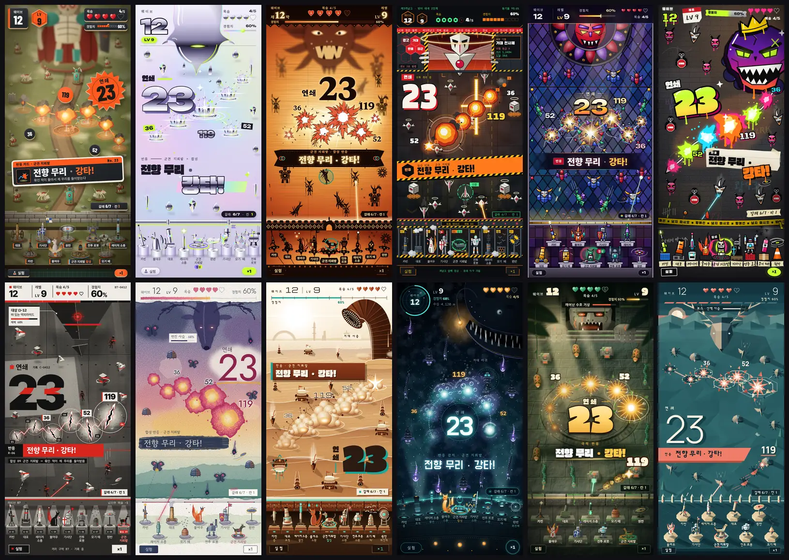

# 컨셉 2차 열두 방향 (2026-11-25)

유저: "딱히 맘에 드는 게 별로 없다. 다양한 컨셉아트부터 더 다양하게 많이. 겹치는 느낌도 난다. 무기마다 그림체 차이 정도는 괜찮다 — 소환수도 동양풍 · 서양풍 · 요괴처럼 같은 갈래 안에서도 그림체가 달라도 된다."

캔버스 쪽 "컨셉 12 (11-25)": https://claude.ai/artifact/Frf9eGGrFij1ctYsvknrDe (비공개). 브리프는 같은 판 상황(웨이브 12 · 연쇄 23 · 전향 무리 · 강타!) + 무기 9개를 방어선 아래 놓인 총처럼 + **소환수 셋을 일부러 다른 그림체로** (불여우 = 동양 요괴, 기사단 = 서양 판타지, 전투 로봇 = SF) → "섞여도 한 판처럼 보이나".

| # | 방향 | 한 줄 | 소환수 셋을 묶은 법 | 강점 | 위험 |
|---|---|---|---|---|---|
| 1 | 미니어처 디오라마 `mini` | 작업대 위 도색 레진 전장, 틸트시프트 · 따뜻한 조명, 해골 군단 | 같은 받침 규격 · 조명 · 심도 | 화풍이 섞여도 "다른 회사 피규어를 한 판에" 처럼 자연스러움 | 폰에서 디테일 뭉개짐, 녹갈색 탁함 |
| 2 | 크롬 Y2K `chrome` | 액체 크롬 · 홀로 포일 · 화보 타이포, 파스텔 원기둥 받침 | 같은 반사 · 홀로 테 · 라임 역광 | 밝은 판, 숫자가 화보처럼 큼 | 은빛 폭발이 약함, 적과 무기가 같은 은색 |
| 3 | 그림자극 `puppet` | 호박 막에 비친 투각 인형극 "제 12 막", 귀면 대왕 | 같은 검은 실루엣 · 관절 핀 · 막대 · 등잔빛 | 연쇄가 막을 뚫는 빛 | 세리프 + 주황 = 옛날 느낌 |
| 4 | 메카 격납고 `mecha` | 거대 천사체가 정문을 비틀어 열고 제3격납고 포대가 지킴 | 같은 셀 음영 · 검은 외곽선 · 갠트리 | 경보 UI · 십자 빛기둥, 도파민 가장 직접 | 에바 연상, 정보량 많음 |
| 5 | 스테인드글라스 `glass` | 성당 창 한 장, 장미창 마왕, 프리즘 연쇄 | 같은 납선 굵기 · 뒤에서 비치는 빛 · 돌 받침 | 고급스럽고 정돈 | 반짝이는 색이 겹쳐 묻힘 |
| 6 | 그래피티 `graffiti` | 밤 옥상 벽 그림이 살아남, 왕관 해골, 테이프 방어선, 우유 상자 · 라바콘 받침 | 같은 오버스프레이 · 흘러내림 · 받침 물건 | 연출이 크게 터짐 | 시끄러움 |
| 7 | 브루탈리즘 초자연 `brutal` | 콘크리트 격리 시설, 스위스 사건 파일, 빨강, 역피라미드 | 회색 · 빨강만 + 위에서 오는 조명 · 좌대 | 큰 "23" 포스터 위계 | 회색 위주라 미니멀과 가까움 |
| 8 | 수채 화첩 `wash` | 노을 물가 한 장, 꽃 번짐 연쇄, 번진 사슴 | 같은 종이 결 · 안료 다섯 · 돌 받침 | 연쇄가 꽃처럼 번짐 | 타격감 약함 |
| 9 | 사막 SF `dune` | 하얀 태양 · 사구 · 거대 사충, 석단 열주 받침 | 같은 석단 · 왼쪽 위 햇빛 · 청록 한 점 | 유일하게 밝고 실루엣 또렷 | 폭발 섬광 약함, 모래색 적이 묻힘 |
| 10 | 심해 `abyss` | 빛나는 것만 보이는 바다, 음파 고리 UI, 거대 아귀, 선체 포탑 우물 | 외곽선 없이 아랫면만 빛 · 같은 바다눈 | 거품 연쇄 속 "23", 도파민 셈 | 선으로 그리면 검정 + 네온 회귀 |
| 11 | 정글 유적 `ruins` | 덩굴 신전 마당, 해시계 홈을 달리는 금빛 연쇄, 거상 | 같은 빛 · 금빛 테두리광 · 안개 · 제단 | 빛살 · 필름 색보정, 영화 같은 폭발 | 어둡고 무거워 탁함, 금이 많아 옛날 쪽 |
| 12 | 저폴리 아이소 `lowpoly` | 해 질 녘 다면 고원, 긴 그림자, 산맥 사슴 | 두 톤 면 · 긴 그림자 · 다섯 색 | 조용하고 정돈, 많아도 읽힘 | 도파민이 식음, 300종 구분 어려움 |
