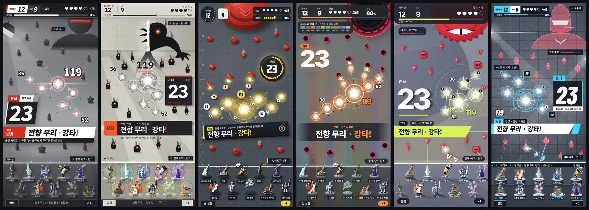

# 중립 무대 여섯 (2026-11-25)

유저: "무기 종류도 그림체도 워낙 많은데, 특정 컨셉에 맞는 무대를 짜면 '쟤가 메인이구나' 싶을까 봐. 하나에 쏠리지 않고 전반적으로 괜찮게."

원칙: 무대(바탕 · 방어선 · 받침) · 적 · 폭발 · UI 는 어느 무기 세계에도 속하지 않는 중립 (채도 낮은 중간 밝기 + 흰색 + 강조 한 색). 색과 그림체는 무기만. 무기를 묶는 건 그림체가 아니라 **공통 처리** (같은 받침 · 같은 조명 방향 · 같은 그림자 · 테두리광).
시험: 무기 10개를 각각 다른 그림체로 (군사 · 디젤 · SF · 동양 요괴 · 서양 판타지 · 메카 애니 · 잉크 코믹 · 미시 생체 · 수정 마법 · 합친 무기) — 어느 하나가 주인공처럼 보이면 무대가 쏠린 것.

캔버스 쪽 "중립 무대 (11-25)": https://claude.ai/artifact/Frf9eGGrFij1ctYsvknrDe

| # | 무대 | 중립을 지킨 법 | 무기를 묶은 법 | 그래도 튄 것 | 강점 | 위험 |
|---|---|---|---|---|---|---|
| 1 | 스튜디오 `studio` | 회색 배경지 · 핀 조명, 적은 얼굴 없는 회색 인형 + 붉은 띠, UI 흰색 + 생방송 빨강, 반응은 방송 자막 | 같은 원통 받침 · 핀 조명 · 왼쪽 위 테두리광 | 불여우 · 확성기 | 어떤 그림체도 전시품으로 들어감 | 회색이 길면 밋밋 |
| 2 | 차원 교차점 `nexus` | 노출 콘크리트 홀, 흰 틈에서 새는 그림자 적 (잉걸 눈), 숯색 안내판 + 잉걸 주황 | 같은 돌 블록 위 고리, 세계색은 고리 테에만 (합친 무기는 두 색) | 고리 덕에 고름, 불여우 · 로봇 약간 | "세계를 잇는 곳" 이야기가 무기 목록과 맞음 | 고리 열 개가 무지개 |
| 3 | 게임 테이블 `board` | 슬레이트 매트 + 격자 · 줄자, 적은 진홍 레진 토큰 (전향 = 뒤집힌 흰 면), 흰색 + 신호 노랑 | 같은 검정 표준 받침 · 조명 필터 · 채도 0.8 | 불여우 · 확성기 | 다른 회사 피규어를 한 판에, 섞여도 어색하지 않음 | 작게 읽힘, 보드게임 말 느낌 |
| 4 | 따라 바뀌는 무대 `adaptive` | 중간 회색 무대에 **가진 무기의 세계가 세로 띠로 옅게** (가진 수만큼 넓게, 범례 칩), 적은 공허 구멍 + 진홍 테 | 같은 회색 받침 · 빛 웅덩이 · 채도 0.82, 이름표 점 = 띠 색 | 코믹 띠 · 메카 띠 · 불여우 | 덱이 바뀌면 무대가 바뀜 = "내 판", 세계 시너지와 이어짐 | 띠가 색 막대처럼 |
| 5 | 추상 그래픽 `abstract` | 회청 · 베이지 중간톤 면 · 큰 원판 · 점 격자, 적은 진홍 기하 생물, 흰색 + 라임 | 같은 원판 · 같은 왼쪽 빛 · 같은 각도의 긴 그림자 ("23" 에도) | 불여우 · 확성기 · 로봇 | 정말 아무 데도 안 속함 | 흰 무기 대비 약함, 차분 |
| 6 | 중계 경기장 `arena` | LED 바닥 · 레인 · 광고판, 적은 빨강 팀 홀로그램 유닛, 점수판 · 다시 보기 · 분석 원 · 자막, 흰색 + 청록 | 같은 빛나는 받침 + LED 띠 · 스포트라이트 | 확성기 · 불여우, 레이저 소총이 무대색과 겹쳐 터줏대감처럼 | 연쇄 · 반응이 중계 그래픽으로 크게, 도파민 가장 셈 | 화면이 시끄러움 |

공통으로 본 것: 어느 무대에서나 **불여우(주홍 불꼬리)와 확성기(노랑 · 글자)가 튄다** → 무대보다 **무기 쪽 규칙**이 더 필요하다 (무기 그림의 채도 · 밝기 상한, 글자 넣지 않기, 받침 위 크기 맞추기).
