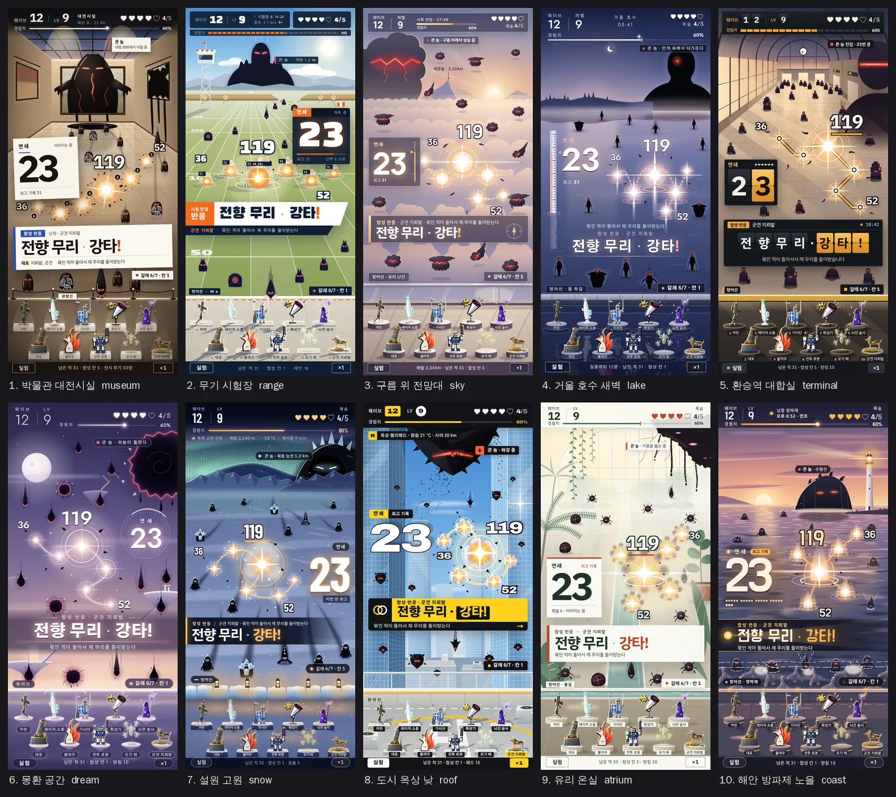

# 중립 무대 2 — 가 보고 싶은 장소 열 (2026-11-25)

유저: "종합(중립) 무대 쪽, 크게 맘에 드는 게 없네. 여럿 뽑아 보자."
지난 여섯(`../c3/`: 스튜디오 · 차원 교차점 · 게임 테이블 · 따라 바뀌는 무대 · 추상 그래픽 · 중계 경기장)은 회색 · 추상 · UI 같은 무대라 차갑고 밋밋했다.

이번 방향: 무대가 **실제로 있을 법한 장소 · 자연 · 건축**이고 빛 · 날씨 · 시간대 · 공기가 있다. 그런데 그 장소는 어느 무기 세계(군사 · 디젤 · SF · 요괴 · 판타지 · 메카 · 코믹 · 세포 · 수정)의 것도 아니라서, 어느 그림체의 무기든 "여기 와 있는 손님"으로 보인다.
- 무대는 예쁘게, 하지만 무기보다 한 단계 조용하게 (채도 · 대비를 무기보다 낮게)
- 적은 그 장소에 **침입한 것**: 어느 무기 세계에도 안 속하는 검은 것 (그림자 · 물감 · 곰팡이 · 물 …) + 붉은 점/틈 하나
- UI 는 그 장소의 말투 (작품 이름표 · 역 숫자판 · 등대 신호 …), 현대적으로
- 무기 10개는 c3 와 **같은 그림** (그래야 무대만 비교된다). 받침 · 빛 · 그림자만 장소에 맞게

캔버스 쪽 "중립 무대 2 (11-25)": https://claude.ai/artifact/Frf9eGGrFij1ctYsvknrDe

| # | 장소 | 시간 · 빛 | 적 (침입한 것) | 방어선 · 받침 | UI 말투 | 그래도 튄 것 | 강점 | 위험 |
|---|---|---|---|---|---|---|---|---|
| 1 | 박물관 대전시실 `museum` | 폐관 뒤 땅거미 천창 + 따뜻한 간접등, 바닥 반사 | 찢어진 큰 풍경화에서 기어 나오는 검은 유화 물감 (장갑 = 깨진 진열장 유리, 돌격 = 붓자국) | 관람선 차단봉 · 흰 전시대 | 작품 이름표 · 오디오 가이드 번호 | 확성기 (흰 레이저는 흰 받침에 묻힘) | 어느 무기든 "소장품" | 어두운 앞쪽에서 적이 덜 보임 |
| 2 | 무기 시험장 `range` | 한낮 역광, 긴 그림자 | 그림자 없는 무광 실루엣 떼, 지평선 그림자 거인 | 콘크리트 사격선 "40 m" · 번호 시험대 | 계측 전광판 · 추적 상자 · "시험 판정" | 카빈이 터줏대감처럼 | 가장 밝고, 거리 숫자로 판이 읽힘 | 군사 시설로 읽힘 |
| 3 | 구름 위 전망대 `sky` | 늦은 오후 살구 · 라벤더, 낮은 해 | 얼굴 없는 폭풍 덩어리 (속에 붉은 번개) | 유리 난간 · 흰 돌 원반 | 훈연 유리 안내판 (고도계 · 나침반) | 흰 레이저 · 로봇 · 보라 술사 | 따뜻하고 가 보고 싶음 | 아래 구름 무늬가 반복돼 보임 |
| 4 | 거울 호수 새벽 `lake` | 푸른 시간 · 분홍 지평선 · 안개 · 초승달 | 물에 비치지 않는 검은 실루엣 (붉은 점 하나, 검은 물결) | 낮은 돌 둑길 · 디딤돌 (무기가 물에 비침) | 선과 글자만: 연쇄 = 수위표, 반응 이름 = 수면 반사 | 불여우 · 대포 | 조용하고 고름, 연출이 또렷 | 지평선 거인이 너무 셈 |
| 5 | 환승역 대합실 `terminal` | 저녁 노을이 유리벽으로 사선 | 얼굴 대신 붉은 틈인 그림자 여행객, 탑승구 뚫는 거인 | 노란 점자 블록 · 화강석 단 + 띠등 · 번호 | 반전식 숫자판, 연쇄 = 노선도 | 레이저 · 로봇 · 수정 (차가운 색) | 따뜻하고 이야기가 있음 | 안내판이 무거움 |
| 6 | 몽환 공간 `dream` | 남보라 → 복숭아 지평선, 큰 달 | 검은 물방울 · 구멍 · 낙수 (가장자리 장밋빛), 하늘에 뚫린 구멍 | 구름 위 돌보 + 빛실 · 오르내리는 뜬 돌 | 가는 글씨, 연쇄 23 = 두 번째 달 | 뇌전 술사가 제집처럼 | 가장 아름답고 조용함 | 보라 하늘 = 마법 세계로 읽힘 |
| 7 | 설원 고원 `snow` | 남청 밤 · 잔잔한 오로라, 무기 줄만 등불로 따뜻 | 검은 서리 망령 (눈 위 검은 자국), 능선 너머 거인 | 깎은 얼음 돌담 · 눈 덮인 검은 돌 단 | 산악 관측소 계기 (해발 · 기온 · 풍속) | 빛나는 레이저 · 모기 떼 · 술사 | 차가운 판 vs 따뜻한 무기 줄 | 넓은 밤 설원이 아직 조금 밋밋 |
| 8 | 도시 옥상 낮 `roof` | 맑은 낮 헬리패드, 유리 반짝임, 또렷한 그림자 | 빛을 먹는 납작한 검은 조각 (장갑 = 검은 결정), 위에 큰 덩어리 | 파라펫 + 유리 난간 + 노란 안전선 · 콘크리트 장비 패드 | 검정 · 노랑 건물 표지 | 굵은 선 확성기 · 로봇 (카빈 · 레이저는 묻힘) | 가장 상쾌하고 현대적 | 공사장처럼 보일 수 있음 |
| 9 | 유리 온실 `atrium` | 오전 7:40 금빛 빛줄기 · 잎 그림자 | 깨진 지붕 유리로 스미는 곰팡이 그림자 (포자 · 딱지 · 흘러내리는 줄기) | 가로 물길 · 이끼 테 석회암 + 꽂이 이름표 | 식물 이름표 · 테라코타 강조 | 불여우 · 뇌전 술사 | 공기가 밝고 숨 쉼 | 하얗게 떠서 얌전해 보임 |
| 10 | 해안 방파제 노을 `coast` | 18:52 역광 · 살구빛 테두리 · 흰 등대 | 바다에서 솟는 검은 물 (물그림자 · 따개비 · 지느러미, 붉은 눈), 수평선 거인 | 표지등 깜박이는 난간 · 호박색 반사띠 콘크리트 기둥 | 등대 신호 (섬광 점 23개) | 흰 레이저 소총 | 가장 가 보고 싶은 그림 | 노을 주황에 불여우 · 대포가 묻힘 |

공통으로 본 것
- 지난 여섯과 달리 **어느 무대도 회색이 아니다**. 그래도 무기 줄은 같은 그림이라, 무대가 바뀌어도 "내 무기"는 그대로 읽힌다.
- **무대 색이 어느 무기 색과 겹치면 그 무기가 묻히거나 터줏대감이 된다**: 노을 · 따뜻한 무대 → 불여우 · 대포 묻힘, 밤 · 차가운 무대 → 레이저 · 수정이 뜸, 보라 하늘 → 술사가 주인, 시험장 → 카빈이 주인. 피할 수 없으니 **무대를 하나로 고정하지 말고 판마다 · 장(챕터)마다 바꾸는** 쪽이 공평하다.
- 적을 "그 장소에 침입한 검은 것 + 붉은 점 하나"로 통일하면 어느 장소에서나 한눈에 적이다.
