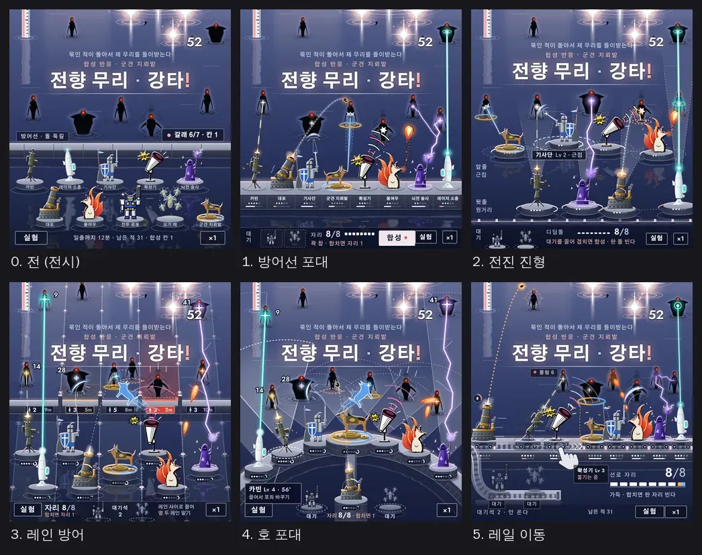
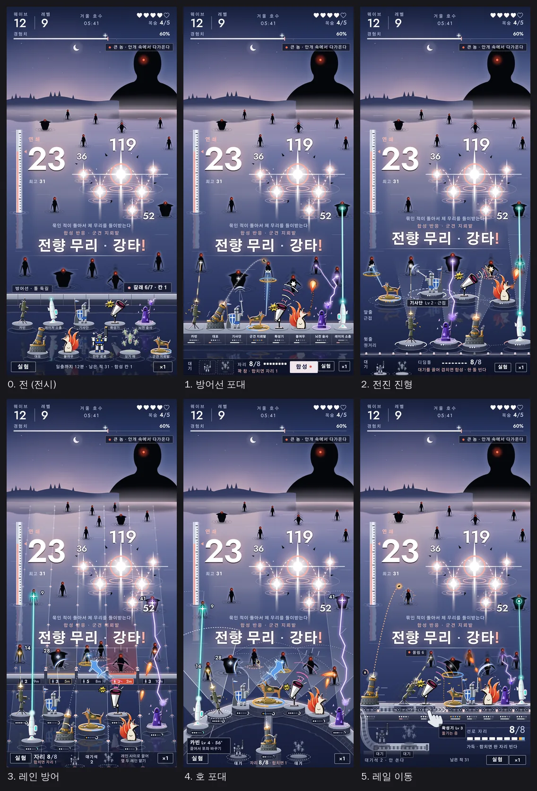

# 하단 UI — 전시가 아니라 배치해서 싸우기 (2026-11-26)

유저: "뽑힌 디자인들 하단 UI 를 바꿔야 될 것 같다. 전시하는 느낌이지 배치해서 싸우고 있다는 느낌이 약하다."

- 바탕은 모두 `c4-lake` (거울 호수 새벽) 그대로 → 하단만 비교
- 같은 순간: 무기마다 제 적을 겨누고 쏘는 중 (탄 · 빔 · 포탄 · 음파 · 번개가 그 무기에서 그 적까지), 받침 자리 **8/8 꽉 참** + 대기석 2 (전투 로봇 · 모기 떼), "합치면 자리 1"
- 자리 규칙은 [`../../slots.md`](../../slots.md) (받침 자리 실험)

캔버스 쪽 "하단 UI · 배치해서 싸우기 (11-26)": https://claude.ai/artifact/Frf9eGGrFij1ctYsvknrDe

| # | 방향 | 무기가 놓인 곳 | 자리 · 대기석 | 손으로 | 강점 | 위험 |
|---|---|---|---|---|---|---|
| 0 | (전) 전시 | 아래 따로 떨어진 판에 받침 두 줄 | 없음 | — | 정돈 | 진열장, 안 싸움 |
| 1 | 방어선 포대 `line` | 둑 윗면 받침 8 위에서 바로 쏨 | 아래 얇은 띠: 대기 2 · "자리 8/8 · 꽉 참" · 합성 버튼 | 합성 버튼 | 규칙이 한눈에 | 간격 빽빽, 앞면 이름표에 진열대 기운 |
| 2 | 전진 진형 `deploy` | 물 위 디딤돌, 앞줄 근접 넷 · 뒷줄 원거리 넷 | 돌 둘레 = 쿨다운, 기슭에 대기 2돌, "끌어 겹치면 합성" | 끌어서 자리 바꾸기 · 겹쳐 합성 · 길게 눌러 사거리 | 전술 판 느낌 | 한 띠에 몰려 복잡 |
| 3 | 레인 방어 `lane` | 부표로 나눈 물길 다섯, 레인 끝에 1~2 | 레인마다 "적 수 · 거리" (급한 레인 빨강), 대기석은 레인 경계 | 대기석을 레인 사이로 끌기 | 급한 곳이 바로 읽힘 | 아래 빽빽 |
| 4 | 호 포대 `arc` | 휜 돌 둑 위 포좌, 가운데 큰 자리에 합친 무기 | 망루에 "자리 8/8", 대기석 양옆 물 위 | 누르면 사격각 · 끌어서 포좌 바꾸기 | 성벽 위엄 | 가운데 무거움, 부채꼴 겹치면 뿌예짐 |
| 5 | 레일 이동 `rail` | 둑 위 선로, 수레 8대가 적 몰린 쪽으로 | 홈 집게 = 자리, 측선 = 대기석 | 수레 끌어 옮기기 | 배치 바꾸기가 손맛 | 아래 1/5 빽빽, 이동 규칙 필요 |

